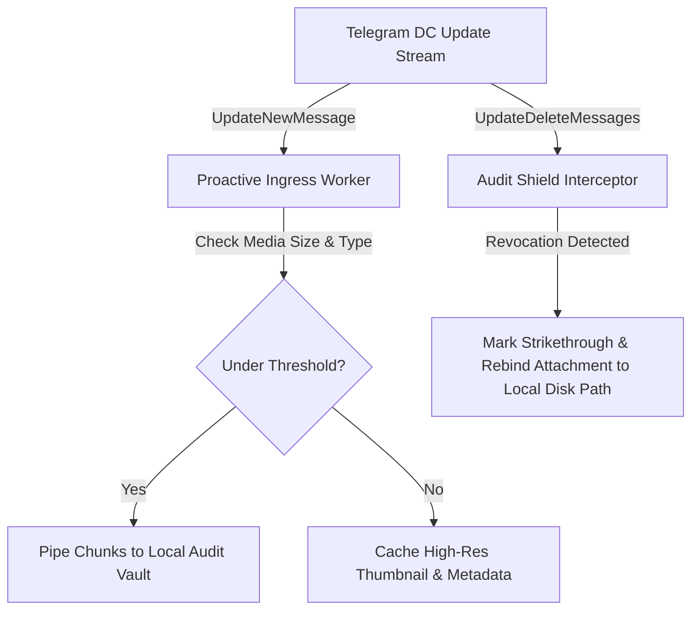

# How We Built an Unlimited Multi-Account Telegram Desktop Client with Isolated Proxies & Anti-Delete Engine

Desktop messaging clients usually treat multi-account support as an afterthought. The official Telegram Desktop client limits users to three active accounts (six with Telegram Premium), shares proxy configurations globally across all profiles, and relies on a single-connection sequential chunk pipeline that chokes on high-latency links.

When managing dozens of personal identities, channels, support bots, and privacy-critical workspaces, this architecture breaks down immediately.

In this deep dive, we break down how we engineered **[Guidegram](https://github.com/guidegram/guidegram)**—an open-source desktop Telegram client built on React 19, TypeScript, and Electron—to solve these fundamental distributed systems challenges:

1. **Unlimited Multi-Account Dock with Hotkey Context Switching** (`Ctrl + 1..9`).
2. **Per-Account Isolated Proxy Routing** (Independent SOCKS5, HTTP, MTProto, and WARP tunnels).
3. **Proactive Anti-Delete Stream Ingress** (Archiving media before Telegram server-side revocation).
4. **Multi-Worker MTProto Parallel Chunk Streaming** (3x–5x download speedups).
5. **Session Encryption & Portable Storage Isolation**.

---

## 1. The Multi-Account Dilemma: Why Desktop Clients Choke

Standard C++ desktop clients (like tdesktop) store session credentials in a monolithic database (`settingss`/`data`) and manage UI styling via global static palettes (`Window::Theme`). Introducing dozens of simultaneous accounts or distinct visual themes per account creates massive refactoring hurdles.

In Guidegram, we decoupled identity management from UI state using an **Isolated Session Vault** model:

```
userData/
  ├── profiles/
  │   ├── account_789123456/
  │   │   ├── session.dat          # Encrypted MTProto auth key & DC salts
  │   │   ├── audit_logs/          # Revocation archive & media cache
  │   │   └── proxy_config.json    # Isolated network tunnel
  │   └── account_987654321/
  │       └── ...
```

### Fluid Vertical Switcher
Instead of hiding profiles inside a hamburger dropdown, Guidegram renders a persistent left-dock with real-time badges, unread message counts, and active DC ping health. Switching between identities is instant via `Ctrl + 1` through `Ctrl + 9` without reloading the DOM or tearing down MTProto background workers.

---

## 2. Zero-Leak Network Isolation: Dedicated Per-Account Proxies

In standard desktop setups, enabling a proxy routes *all* your Telegram accounts through that single IP. If one proxy gets flagged or experiences jitter, your entire fleet disconnects simultaneously.

Guidegram isolates the transport layer completely:
- **Account A** connects via a dedicated residential SOCKS5 proxy in Germany.
- **Account B** connects through a high-speed MTProto proxy in Netherlands.
- **Account C** connects directly or over local Cloudflare WARP.

Each account’s MTProto transport client instantiates its own `socks` or `tls` socket agent with custom DNS resolution, ensuring zero cross-contamination of network fingerprints:

```typescript
// electron/telegram/networkTunnel.ts
export function createAccountAgent(config: ProxyConfig): http.Agent | https.Agent | SocksAgent {
  if (config.type === 'socks5') {
    return new SocksProxyAgent({
      hostname: config.host,
      port: config.port,
      userId: config.username,
      password: config.password,
    });
  }
  // MTProto channel or direct TLS fallback
  return new https.Agent({ keepAlive: true, timeout: 15000 });
}
```

---

## 3. The Anti-Delete Paradox: Why Media Disappears After Message Revocation

Many users wonder why third-party clients with "Anti-Recall" features can preserve message text, but fail when you try to open the attached photo or video after it has been deleted.

### The Protocol Reality
Telegram servers do not serve raw file URLs. Media access is gated by cryptographic tokens called `file_reference`. The moment a channel administrator or sender revokes a message:
1. Telegram servers invalidate the `file_reference`.
2. Any subsequent `upload.getFile` request from a client returns `400 FILE_REFERENCE_EXPIRED` or null.

Clients that rely on **lazy loading** (only fetching the video when the user scrolls to it) will always fail if the deletion occurred while the user wasn't looking at that specific chat.

### The Solution: Proactive Stream Ingress
Guidegram solves this by intercepting the raw MTProto update stream before it reaches the UI:



When a deletion event arrives, Guidegram marks the message with a red deletion timestamp, preserves the text, and swaps the remote CDN pointer with the local file path stored under `./data/audit_logs/`.

---

## 4. Multi-Worker Parallel Chunk Streaming: 3x-5x Speedups

Telegram Desktop transfers files over single TCP connections using standard 128KB/512KB chunks. Under international packet loss or high RTT, single-stream TCP windowing limits download throughput to a fraction of available broadband capacity.

Guidegram implements a **Multi-Worker MTProto Pipeline**:
1. Connects 4 to 8 parallel MTProto worker sockets directly to the target DC hosting the media.
2. Segments the file into 512KB slices distributed across workers in round-robin offsets (`offset = worker_index * chunk_size`).
3. Streams incoming chunks into a pre-allocated sparse file descriptor using direct random-access writes (`fs.write(fd, buffer, 0, bytes, offset)`).

This eliminates in-memory buffer bloat and achieves line-rate throughput even on 1GB+ video files.

---

## 5. Security & Portable Zero-Install Architecture

Guidegram was designed from day one to operate without leaving forensic footprints in the host operating system's registry:
- **Zero Windows Registry Dependency**: Runs in full portable mode from USB drives or isolated folders.
- **Argon2id Master Passcode Guard**: All cached sessions, message archives, and proxy credentials are encrypted with AES-256-GCM.
- **Ephemeral Sandbox**: Quitting the app flushes in-memory decryption keys instantly.

---

## Try It Out & Contribute

Guidegram is 100% open-source:
- **GitHub Repository**: [https://github.com/guidegram/guidegram](https://github.com/guidegram/guidegram)
- **Official Telegram Channel**: [@GuideGram_Official](https://t.me/GuideGram_Official)
- **Discussion Community**: [@GuidegramGroup](https://t.me/GuidegramGroup)

Feel free to star the repo, test the portable release, or contribute pull requests!
